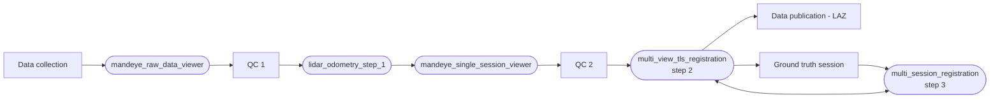

# AGENTS.md

Guidance for coding agents (and humans) working on HDMapping. The rules come from maintainer review comments.

## Project

HDMapping is the processing toolset for the Mandeye mobile mapping system. C++20, CMake >= 4.0. For supported
platforms, see "Platforms and portability" below.

- `core/`, `calib_core/`: shared libraries (point clouds, registration, raylib rendering in the `core_raylib` target).
- `shared/include/HDMapping/`: header-only utilities (`Assert.h` with `HDMAPPING_ASSERT`, `PoseInterpolation.h`,
  `SessionPaths.h`).
- `apps/`: the tools. Main workflow: `mandeye_raw_data_viewer`, `lidar_odometry_step_1`, `multi_view_tls_registration`
  (step 2), `multi_session_registration` (step 3). The `*_legacy` apps are the GLUT versions kept next to the raylib
  ports. New rendering work goes into the raylib code.
- `3rdparty/`: git submodules built from source. `3rdpartyBinary/`: prebuilt OpenCV and PROJ. Both are wired up in
  `cmake/dependencies.cmake`.
- `scripts/`: developer tooling, documented in `scripts/README.md`.
- User documentation lives in the [GitHub wiki](https://github.com/MapsHD/HDMapping/wiki), not in the repo. File formats are described in
  [File Formats](https://github.com/MapsHD/HDMapping/wiki/File-Formats).

## Build and check

```bash
git submodule update --init --recursive
cmake -B build -DCMAKE_BUILD_TYPE=Release -DBUILD_WITH_UTILITY_APPLICATION=ON -DBUILD_TESTING=ON
cmake --build build -j
ctest --test-dir build --output-on-failure
python3 scripts/run_check_clang_format.py  # needs clang-format 21 (same as CI); reformats files in place
```

Ubuntu packages are listed in `ubuntu-24.04-apt-requirements.sh`. CI (`.github/workflows/`) builds Linux, Windows,
macOS, the Debian package and the Python bindings. It fails on any clang-format difference.

## Scope of a change

- One concern per PR. A bug fix and a feature or UX change go in separate PRs, even when they were found together.
- A bug found along the way (UB, race, crash) gets an issue and a minimal fix of a few lines, such as a mutex. Don't
  rewrite the code around it.
- Keep diffs reviewable. Agent-written code is fine, but a large diff that mixes fixes, refactors, tests and UX will
  be sent back to be split.
- Performance work must not change results. Give before/after timings.

## Existing workflows

- Changes must not break existing workflows. The processing chain below must keep working end to end.



- Files written by earlier versions must still load: [raw sessions](https://github.com/MapsHD/HDMapping/wiki/File-Formats#raw-session-mandeye-recording),
  sessions ([`.mjs`](https://github.com/MapsHD/HDMapping/wiki/File-Formats#sessionmjs)), projects ([`.mjp`](https://github.com/MapsHD/HDMapping/wiki/File-Formats#step-3-project-mjp)),
  calibrations ([`.mjc`](https://github.com/MapsHD/HDMapping/wiki/File-Formats#calibrationjson--mjc)) and
  [step outputs](https://github.com/MapsHD/HDMapping/wiki/File-Formats#step-1-output-lio_result_n). If you change a format, keep reading the old one and
  update [File Formats](https://github.com/MapsHD/HDMapping/wiki/File-Formats) in the wiki.
- Existing command-line options and parameters keep their names and meaning. Add new ones rather than renaming or
  repurposing old ones.
- Call out in the PR description any change users will notice: defaults, output files, results.

## Reuse before adding

- Search `core/` and `shared/` before adding a struct, helper or class. Don't duplicate one that already exists.
- When a library already has a facility, use it instead of writing your own: raylib's mesh and buffer drawing,
  Eigen's `Map` and `cast`.
- A new class with its own responsibility gets its own `.h`/`.cpp` pair and a short doc comment. Don't append it to a
  large existing `.cpp`.

## Platforms and portability

- **Tier 1: Latest Windows 11.** Every change must build and work here. Test user-facing changes on Windows before merging.
- **Tier 2: macOS and Ubuntu 24.04.** Every change must build and work here too. CI builds and tests both on every PR.
- **Tier 3: everything else** (other Linux distributions and versions, other architectures, Windows 10). Best effort. Fixes are
  welcome as long as they don't affect tier 1 or tier 2.
- Features that work on only one platform are not merged.
- Paths: use `std::filesystem::path` and `operator/`, never string concatenation with `"/"`.
- Optional or debug behaviour goes behind a CMake option or preprocessor flag. Don't leave code commented out.

## Build and third-party libraries

- The build is self-contained. After `git clone --recursive` and installing the documented system packages (apt on
  Linux, Homebrew on macOS), `cmake -B build && cmake --build build` works on every tier 1 and tier 2 platform. A
  change must not add any other manual step, such as running a script or downloading a file by hand.
- Third-party libraries are built from source as `3rdparty/` submodules wherever possible.
- If a library can't be built from source, CMake downloads prebuilt binaries and checks a pinned SHA256 (see
  `3rdpartyBinary/`). They come from the library's official release (e.g. OpenCV for Windows) or, if upstream ships
  none, from a CI workflow in a repository of the MapsHD GitHub organization (e.g. PROJ for Windows from
  `MapsHD/proj_win_deploy`). Binaries built by hand are not accepted.
- System packages from the platform's package manager (apt, Homebrew) are fine. A new one goes into
  `ubuntu-24.04-apt-requirements.sh`, the CI workflows and the build docs in the same PR.
- Every tool in the toolset links against the same version of each third-party library. Don't give one tool its own
  copy or its own way of getting a library (e.g. one tool building its own PROJ while the others use the shared one).
  Changing a library for one tool means changing it for all of them.
- Don't move submodule commits by accident. Check `git diff --submodule` before committing.

## One product, one release

- All tools share the version in the top-level `CMakeLists.txt` (`project(hd-mapping VERSION ...)`) and are released
  together. No tool gets its own version, CI workflow, release script or packaging script.
- A toolchain bump (CMake, compiler) updates the CI workflows and the build docs in the same PR.
- Packaging is done in one place per platform: `deploy_mandeye.bat` (Windows), `macos_bundle_toolkit/` (macOS) and
  CPack (Debian).

### Adding a new executable

Nothing fails if you miss one of these steps:

1. `add_subdirectory(apps/<tool>)` in the top-level `CMakeLists.txt`, under the right `BUILD_WITH_*` option. Without
   it the tool isn't built.
2. `hdmapping_install_app(<target>)` in the tool's `CMakeLists.txt`. Without it the tool is missing from the install
   and the Debian package.
3. The `EXPECTED` list in `deploy_mandeye.bat`. Without it the Windows deploy doesn't warn when the tool stops being
   built.

## Tests

- Unit tests (doctest, enabled with `BUILD_TESTING`) are for logic with a clear contract: math, parsing,
  interpolation, file formats.
- Don't add tests for things you can check by looking at the output (rendering, GUI, UX). They are a maintenance
  burden. A test must not encode an agent's reasoning steps.

### Test datasets

Run changes to the processing chain against a real recording before opening a PR. Datasets are not stored in the repo;
download them outside the source tree.

- [Underground Parking Dataset](https://huggingface.co/datasets/MichalPelka/UndegroundParkingDataset): handheld
  Mandeye recording of an underground garage (25 chunks, ~240 MB, Livox LiDAR + IMU, no GNSS) with a Z+F IMAGER 5010
  TLS scan as ground truth (`ground-truth/`, own local frame, register before comparing). Feeds
  `mandeye_raw_data_viewer` and `lidar_odometry_step_1` directly. Get it with `git lfs install` and
  `git clone https://huggingface.co/datasets/MichalPelka/UndegroundParkingDataset`.

## Docs and comments

- No design docs or agent notes in the source tree. Lasting guidance for agents belongs in this file, trimmed by a
  human.
- Per-user agent notes (plans, analyses, implementation notes for your own PR or commit) go in `agents/`. Git ignores
  everything there except its `.gitignore`. Code, commit messages, PR descriptions and tracked docs must not refer to
  files in `agents/`; they exist only on one machine.
- Every developer tool gets a line in `scripts/README.md`.
- Doc comments use `//!` Doxygen on declarations. Keep them short.

## CI etiquette

- A commit that touches only docs, images or the README gets `[skip ci]` in its message.
