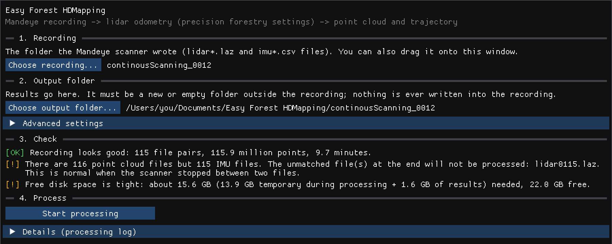

# Easy Forest HDMapping

Easy Forest HDMapping is a single window that turns the folder a Mandeye scanner records into a 3D point cloud (a `.laz` file)
and the path you walked (a `.csv` file). It uses the processing settings that HDMapping recommends for forests, so there
is nothing to tune.



- [Who it is for](#who-it-is-for)
- [What your computer needs](#what-your-computer-needs)
- [Installation](#installation)
- [How to use it](#how-to-use-it)
- [Processing many recordings](#processing-many-recordings)
- [What you get](#what-you-get)
- [Troubleshooting](#troubleshooting)
- [Getting help](#getting-help)
- [Credits and license](#credits-and-license)

## Who it is for

Easy Forest HDMapping is for anyone who walks a forest plot with a Mandeye scanner and wants a point cloud without learning the
full HDMapping toolchain: forestry partners, students, field crews. It is designed for forests; it works elsewhere, but
its settings are tuned for forests.

What it does **not** do:

- **One point cloud per walk.** Each recording becomes its own point cloud. It can process many recordings in one go
  (see [Processing many recordings](#processing-many-recordings)), but it does not merge several walks into one cloud.
- **No real-world coordinates.** It does not use GNSS or ground control points. Coordinates are in metres, starting at
  the spot where you started walking, with the vertical axis (Z) pointing up.
- **No loop closure yet.** If you return to your starting point, small drift is not corrected. (Planned for a later
  version.)
- **One lidar only.** Scanners with two or more lidars are refused by the check.

For any of these, use the full HDMapping apps (see the
[HDMapping wiki](https://github.com/MapsHD/HDMapping/wiki)). Easy Forest HDMapping keeps its intermediate results so that you
can continue there.

## What your computer needs

| | Mac | Windows |
|---|---|---|
| System | macOS 13 (Ventura) or newer | Windows 10 or 11, 64-bit (not yet tested on a real PC) |
| Processor | Apple silicon (M1 or newer). Intel Macs are not supported in v1. | 64-bit Intel or AMD processor |
| Memory (RAM) | 16 GB recommended | 16 GB recommended |

**Memory:** a 10-minute walk needs about 9 GB of memory while it is being processed. Longer walks need more. Close
other large programs while Easy Forest HDMapping is working.

**Disk space, rule of thumb:** while processing, Easy Forest HDMapping needs free space of about **20 times the size of the
recording's lidar files**, which is roughly **1.5 GB per minute of walking**. About a tenth of that stays as results;
the rest is freed when processing ends. You do not have to work this out yourself: the check (step 3 below) tells you
exactly how much is needed and how much is free.

**Time:** on a recent laptop, processing takes about twice as long as the walk (a 10-minute walk takes about
20-25 minutes).

## Installation

Easy Forest HDMapping is free and needs no account. Your computer will warn you the first time you open it, because the program
is not signed by a company that Apple or Microsoft knows. The steps below show how to get past the warning; you only
need to do this once.

### Mac

1. Open the [releases page](https://github.com/MartinMokros/HDMapping-Easy-GUI/releases) and download the newest Easy Forest HDMapping release: the file
   **`EasyForestHDMapping-mac.dmg`** under *Assets*.
2. Double-click the `.dmg` file. In the window that opens, drag **Easy Forest HDMapping** onto the **Applications**
   folder.
3. Open your **Applications** folder and double-click **Easy Forest HDMapping**.
4. macOS says **"“Easy Forest HDMapping” Not Opened"** (Apple could not verify it is free of malware). Click
   **Done**.
5. Open **System Settings** → **Privacy & Security**. Scroll down to the **Security** section. Next to the line
   **"“Easy Forest HDMapping” was blocked to protect your Mac."** click **Open Anyway**.
6. Enter your Mac password (or use Touch ID), then click **Open Anyway** once more in the dialog that appears.

From now on Easy Forest HDMapping opens normally. If macOS ever says the app **"is damaged and can't be opened"**, see
[Troubleshooting](#troubleshooting).

### Windows (not yet tested on a real PC)

The Windows version is built and its automatic tests pass, but nobody has used it on a real Windows PC yet. If
something goes wrong, please report it (see [Getting help](#getting-help)).

1. Open the [releases page](https://github.com/MartinMokros/HDMapping-Easy-GUI/releases) and download the newest Easy Forest HDMapping release: the file
   **`EasyForestHDMapping-windows.zip`** under *Assets*.
2. Before unpacking: right-click the downloaded `.zip` file → **Properties** → on the **General** tab, tick
   **Unblock** at the bottom → **OK**. (If there is no Unblock box, skip this step.)
3. Right-click the `.zip` file → **Extract All…** → choose a folder, for example `Documents\Easy Forest HDMapping`
   → **Extract**. Keep all files in that folder together: Easy Forest HDMapping needs the other files next to it.
4. Open the folder and double-click **`easy_gui.exe`**.
5. If a blue window says **"Windows protected your PC"**: click **More info**, then **Run anyway**.

Tip: right-click `easy_gui.exe` → **Show more options** → **Send to** → **Desktop (create shortcut)** to start it
from your desktop next time.

## How to use it

At the top of the window, choose **One recording** (described here) or **Several recordings** (see
[Processing many recordings](#processing-many-recordings)). The window guides you through four steps, top to bottom.

**1. Recording.** Click **Choose recording…** and select the folder the scanner wrote, for example
`continousScanning_0012`. It contains files named `lidar0000.laz`, `imu0000.csv` and so on. You can also drag the
folder onto the window. You can work straight from the scanner's USB stick: Easy Forest HDMapping never changes or adds
anything in the recording folder. Copying the folder to your computer first makes processing a little faster.

**2. Output folder.** Easy Forest HDMapping suggests `Documents/Easy Forest HDMapping/<name of the recording>`. To use a
different place, click **Choose output folder…**. The folder must be new or empty.

**3. Check.** Easy Forest HDMapping checks the recording and the free disk space automatically. Each line is marked:

- **[OK]** (green): all good.
- **[!]** (amber): worth knowing, but you can go on.
- **[X]** (red): this must be fixed before you can start. See [Troubleshooting](#troubleshooting).

**4. Process.** Click **Start processing**. Easy Forest HDMapping shows which stage it is in, a progress bar and the time left.
You can keep using your computer, but it will be busy. **Cancel** stops processing and deletes the unfinished results.
Closing the window also stops processing.

When it is done, click **Open output folder** to see the results, or **Process another recording** to start again.

**Advanced settings** (you normally do not need these):

- **Closest points kept** (default 0.4 m): points closer to the scanner than this are left out. The default removes
  the operator's body and the scanner handle. A lower value keeps more of the close surroundings, but may include you.
- **Place all points by their measurement time (experimental)**: an alternative way of placing the points. Tests showed
  it slightly less sharp than the default, so leave it off unless you are comparing the two.
- **Keep intermediate files**: keeps extra working files, useful when reporting a problem.

## Processing many recordings

After a field day you often have many recordings, for example one per plot. Easy Forest HDMapping can process all of
them one after another, unattended, for example overnight.

1. At the top of the window, choose **Several recordings**.
2. **Folder with recordings.** Click **Choose folder…** and select the folder that *contains* the recording folders,
   for example a copy of the scanner's USB stick. You can also drag it onto the window. Easy Forest HDMapping looks in
   the folders directly inside it (not deeper). If the folder you chose is itself a recording, it is included too.
3. **Output folder.** Easy Forest HDMapping suggests `Documents/Easy Forest HDMapping/<name of the folder>`. Each
   recording's results go into a folder of its own inside it.
4. **Recordings.** A table lists every recording found:

   | Column | Meaning |
   |---|---|
   | Include | Untick a recording to leave it out. Recordings that fail the check cannot be ticked. |
   | Recording | The folder name. Point at it to see the full path. |
   | Length | How long the walk was. |
   | Check | **[OK]**, **[!]** (worth knowing, you can go on) or **[X]** (cannot be processed). Point at it for the details; problems are also listed in words below the table. **already done** means this recording was finished in an earlier run and will be skipped. |
   | Output folder name | The name of this recording's results folder. You can change it. Two recordings cannot use the same name (upper and lower case count as the same). |

   Folders that are not recordings are listed under **folders skipped**, with the reason. Below the table, the disk
   check tells you how much space the whole batch needs: the temporary space of the largest recording (recordings are
   processed one at a time, and each frees its temporary space when it is done) plus the results of all of them.
5. **Process.** Click **Start processing**. You see the progress of the whole batch with the time left, which
   recording is being processed, and the status of each recording in the table. Your computer will not go to sleep
   while the batch runs (the screen may still turn off). Leave the power adapter connected.

If a recording fails, it is marked **failed** and the batch goes on with the next one. Point at **failed** in the table
to see why; the recording's own `easy_gui.log` has the details.

**Stopping.** **Stop after this recording** lets the current recording finish and then stops. **Stop now** stops
immediately and discards the current recording; recordings already finished are kept.

**Continuing a stopped batch.** Choose the same folder with recordings and the same output folder again. Recordings
that were finished show **already done** and are skipped; the others are processed, including the ones that failed
before. This also works after a power cut or a crash. (Each finished recording's folder contains a small file,
`easy_gui_done.txt`, that marks it as finished. Delete that file to process the recording again.)

**What you get.** The output folder contains one folder per recording, each with the files described in
[What you get](#what-you-get), plus two files about the whole batch:

| File | What it is |
|---|---|
| `batch_summary.csv` | One row per recording: recording folder, output folder name, status (`succeeded`, `failed`, `already_done`, `cancelled`, `not_run`, `excluded`, `skipped`), processing time in seconds, number of raw points, number of points in the point cloud, results folder, and the error message if any. Opens in any spreadsheet program. |
| `batch.log` | What happened in the batch, with times. |

**Without the window.** The batch can also be started from a terminal, for example on a computer without a screen:

```
easy_gui --batch <folder with recordings> <output folder>
```

On a Mac the program is `"/Applications/Easy Forest HDMapping.app/Contents/MacOS/easy_gui"`; on Windows,
`easy_gui.exe` in the folder you extracted. It follows the same rules as the window: every recording that passes the
check is processed, and finished ones are skipped. Press Ctrl+C once to stop after the current recording, twice to stop
now. The program ends with exit code 0 if every recording succeeded or was already done, and 1 otherwise.

## What you get

The output folder contains:

| File | What it is |
|---|---|
| `point_cloud.laz` | The point cloud. Opens in CloudCompare, QGIS, LAStools, lidR and most other point cloud software. |
| `trajectory.csv` | The path of the scanner: where it was and which way it pointed, about 200 times a second. Opens in any spreadsheet program. |
| `README.txt` | A description of both files, with the numbers of this particular run. |
| `easy_gui.log` | A record of everything that happened during processing. Useful when asking for help. |
| `work/` | Intermediate results. `work/lio_session/session.mjs` can be opened in the full HDMapping apps to improve the result further or to give it real-world coordinates. |

### The point cloud (`point_cloud.laz`)

Every point has these values:

| Field | Meaning |
|---|---|
| X, Y, Z | Position in metres. (0, 0, 0) is where you started walking; Z points up. |
| intensity | How strongly the surface reflected the laser. Bright, smooth surfaces give high values. |
| gps_time | When the point was measured, in seconds since 1 January 1970 (UTC). Despite the name, this is not GPS time. |
| point_source_id | Which roughly 5-second piece of the walk the point belongs to. |
| user_data | Which lidar measured the point (always the same, since Easy Forest HDMapping handles one lidar). |
| **range_m** | **Distance from the scanner to the point when it was measured, in metres.** Far points are less precise than near ones, so this is useful for keeping only points measured from close by, for example only points closer than 15 m for measuring stem diameters. |
| **point_origin** | **Where the point comes from:** |
| | **0** — the main points, placed by HDMapping's motion tracking (lidar odometry). Most of the cloud. |
| | **1** — close-range points. HDMapping's motion tracking ignores everything within 1 m of the scanner; Easy Forest HDMapping adds these points back afterwards (from the "Closest points kept" distance outwards), so the ground and stems right next to your path are not missing. |
| | **2** — filled-in points. HDMapping's motion tracking works in tenth-of-a-second pieces and skips a few milliseconds between them; Easy Forest HDMapping adds the points measured in those short gaps. |

Points 1 and 2 line up with the main points typically within a millimetre, and in 99 % of cases within about 1 cm.
You can switch them off by filtering on `point_origin`, for example to see exactly what HDMapping alone would have
produced.

### The trajectory (`trajectory.csv`)

One row per scanner position, with a header row. The most useful columns:

| Column | Meaning |
|---|---|
| timestamp_unix_s | Time, in the same seconds as the point cloud's gps_time. |
| x, y, z | Position of the scanner in metres, in the same coordinates as the point cloud. |
| qw, qx, qy, qz | Which way the scanner pointed, as a quaternion. |
| om_deg, fi_deg, ka_deg | The same direction as three angles in degrees. |
| scan_index | Matches point_source_id in the point cloud. |

`README.txt` describes the remaining columns.

### Colouring the point cloud by a field in CloudCompare

[CloudCompare](https://www.cloudcompare.org) is free and opens `point_cloud.laz` directly.

1. **File → Open**, choose `point_cloud.laz`. In the dialog that lists the fields, keep everything ticked and click
   **Apply all**.
2. Click the point cloud in the **DB Tree** panel on the left.
3. In the **Properties** panel below it, find **Colors** and choose **Scalar field**.
4. Just below, under **Scalar Fields**, set **Active** to `range_m` or `point_origin` (or `Intensity`).
5. To keep only some points, for example only the main points: **Edit → Scalar fields → Filter By Value**, enter a
   range (for example 0 to 0 for `point_origin`), and click **Export**. CloudCompare creates a new cloud with only
   those points.

## Troubleshooting

The check (step 3) explains problems in plain words. Here is what to do about each one.

**Problems with the recording**

| Message (shortened) | What to do |
|---|---|
| "The recording folder … does not exist or is not a folder." | Choose the folder again; the USB stick may have been unplugged. |
| "This folder does not look like a Mandeye recording: there are no point cloud files / no IMU files." | You chose the wrong folder. Choose the folder that contains `lidar….laz` and `imu….csv` files, for example `continousScanning_0012`, not the folder above or below it. |
| "There are N point cloud files but M IMU files. The unmatched file(s) at the end will not be processed." | Just information. Usually the scanner stopped between two files; the last few seconds are left out. |
| "Some file numbers do not match." | A file is probably missing in the middle of the recording (for example after an incomplete copy). Copy the recording from the scanner again. If that does not help, the result may have a gap at that point. |
| "These point cloud files cannot be read (damaged, or not fully copied from the scanner)." | Copy the recording again. If the damaged files are the last ones, you can also delete them from your copy. |
| "This recording contains data from more than one lidar." / "…describes more than one lidar." / "…lists more than one lidar." | Easy Forest HDMapping handles single-lidar scanners only. Use the full HDMapping apps. |
| "The calibration file … could not be read and will be ignored." | Just information, processing continues without it. If your scanner needs a calibration file, ask whoever set up the scanner for a correct one. |
| "The calibration file … belongs to a different scanner." / "… does not name a valid IMU." | The calibration file in the folder does not match the scanner. Remove it from your copy of the recording, or replace it with the right one. |
| "The IMU files could not be read." | The motion-sensor files (`imu….csv`) are damaged or empty. Copy the recording again. |
| "The IMU and point cloud timestamps do not overlap." | The recording is damaged; the two kinds of files do not belong together. Copy it again from the scanner. |
| "The recording is very short." | Just a warning. Processing needs some walking; recordings of less than about 20 seconds may give poor results. |

**Problems with the output folder**

| Message (shortened) | What to do |
|---|---|
| "Choose an output folder." | Click **Choose output folder…**. |
| "The output folder is inside the recording folder." | Choose a folder somewhere else. Easy Forest HDMapping never writes into the recording. |
| "The output folder … already contains files." | Choose a new or empty folder, or empty this one first. |
| "Not enough free disk space …" | Free some space (the message says how much is needed), or choose an output folder on another disk with more space. |
| "Free disk space is tight." | You can start, but make sure nothing else fills the disk while Easy Forest HDMapping works. |
| "Could not determine the free disk space." | Usually harmless. Make sure the disk has plenty of space (see the rule of thumb above). |
| "The output folder holds an unfinished earlier attempt." (several recordings) | Just information: the recording did not finish last time. Its old files are replaced; its log is continued. |
| "Not enough free disk space for the batch …" (several recordings) | Free some space, choose an output folder on another disk, or untick some recordings and process them later. |
| "The output folder is inside the recording …" (several recordings) | The folder with recordings is itself a recording, and the output folder is inside it. Choose an output folder somewhere else. |
| Output folder name shown in red (several recordings) | The name is empty, contains a character a folder name cannot have (such as `/`, `\`, `:`, `*`, `?` or a vertical bar), or another recording uses it. Point at it to see which. |

**Problems during processing**

| Message | What to do |
|---|---|
| "Easy Forest HDMapping could not find the lidar odometry program …" | Some files of the installation are missing. Install Easy Forest HDMapping again and keep all its files together. |
| "Lidar odometry stopped unexpectedly." | Most often the computer ran out of memory. Close other programs and try again. If it happens again, see [Getting help](#getting-help). |
| "Could not create the output folder …" / "Could not write …" | The disk may be full, or you may not be allowed to write there. Choose another output folder. |

**Mac: "“Easy Forest HDMapping” is damaged and can't be opened."** This sometimes happens with downloaded apps that
are not signed. Open the **Terminal** app, paste the following line and press Enter, then open Easy Forest HDMapping again:

```
xattr -dr com.apple.quarantine "/Applications/Easy Forest HDMapping.app"
```

## Getting help

Open an issue at <https://github.com/MartinMokros/HDMapping-Easy-GUI/issues> and attach `easy_gui.log` from the
output folder. Describe what you did and which message you saw.

## Credits and license

Easy Forest HDMapping is built on [HDMapping](https://github.com/MapsHD/HDMapping) by Janusz Będkowski and the MapsHD
contributors. All the processing (motion tracking and point placement) is HDMapping's; Easy Forest HDMapping adds the window,
the checks and the export. Easy Forest HDMapping and HDMapping are released under the [MIT License](../../LICENSE).

If you use the results in your work, please cite HDMapping:

```bibtex
@article{BEDKOWSKI2024101618,
     title = {Open source, open hardware hand-held mobile mapping system for large scale surveys},
     journal = {SoftwareX},
     volume = {25},
     pages = {101618},
     year = {2024},
     issn = {2352-7110},
     doi = {https://doi.org/10.1016/j.softx.2023.101618},
     url = {https://www.sciencedirect.com/science/article/pii/S235271102300314X},
     author = {Janusz Będkowski}
}
```

How Easy Forest HDMapping works and how its results were checked is described in [docs/DESIGN.md](docs/DESIGN.md).
